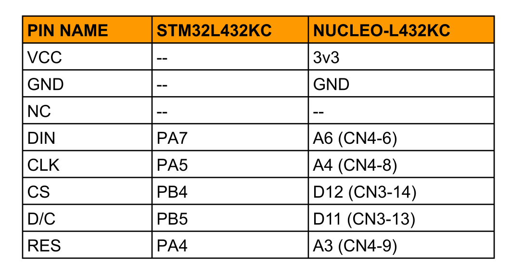
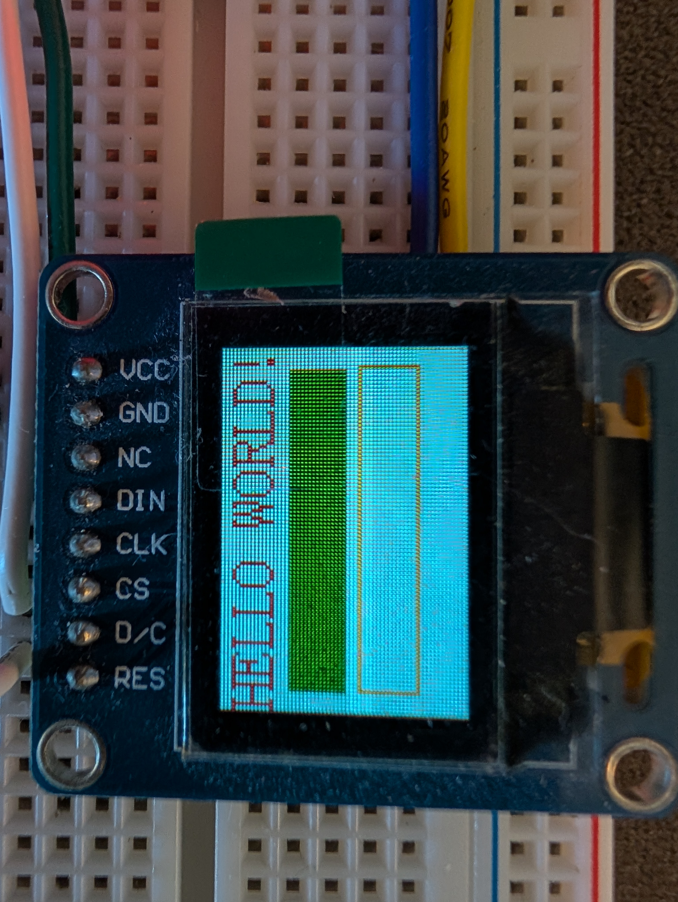
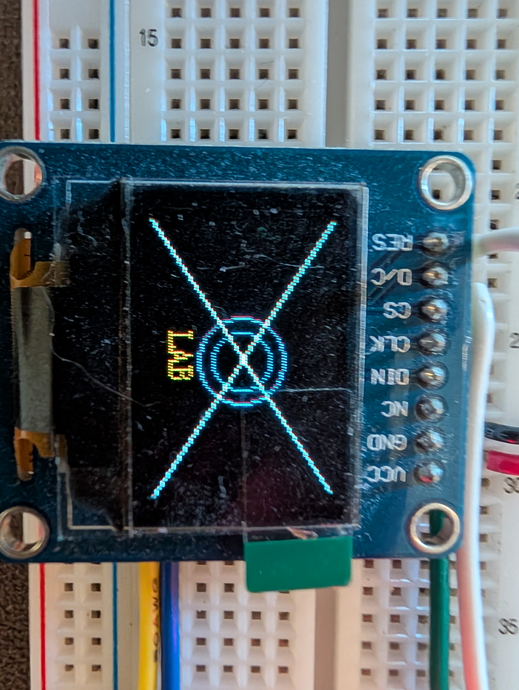

# uart_cli_waveshare
****
uart command line interface for STM32L432KC ([NUCLEO-L432KC](https://www.st.com/en/evaluation-tools/nucleo-l432kc.html)) with a waveshare display attached. The attached [waveshare display](https://www.waveshare.com/0.95inch-rgb-oled-b.htm?srsltid=AU7gw4WJSU-8IOkTb82Uvh5fFLvzlbeXpaQjFDIYvCpGQVy90cQC37zv) is 96x64 pixels and is supplied via the 3v3 pin on the NUCLEO-L432KC.

## Display Pinout



## Connecting to the NUCLEO-L432KC

Once the above connections are made and the STM32L432KC is programed with the appropriate firmware. Plug in the board, get its device id and connect with a baud rate of 115200.

```bash
# Connect
sudo screen /dev/ttyACM0 115200
```

## Command List

*Note all commands if sent without the colon will print the usage to the serial terminal*

* clear &ensp;&ensp;- clears screen to a specific color
* fill &ensp;&ensp;&emsp;- draws a filled rectangle of any color
* rect &emsp;&ensp;- draws a rectangle
* circle &ensp;&ensp;- draws a unfilled circle
* line &ensp;&emsp; - draws a line in the specified color
* stext &ensp;&ensp; - draws small text to the screen
* ltext &ensp;&ensp; - draws large text to the screen

**Examples**
```
clear:WHITE
ltext:0,0,HELLO WORLD!,RED,WHITE
fill:5,18,85,15,GREEN
rect:5,36,85,15,YELLOW
```


```
clear:BLACK
circle:48,32,10,BLUE
circle:48,32,15,PURPLE
line:0,0,95,63,PINK
line:0,63,95,0,PINK
stext:38,48,LAB,GOLDEN,BLACK
```

